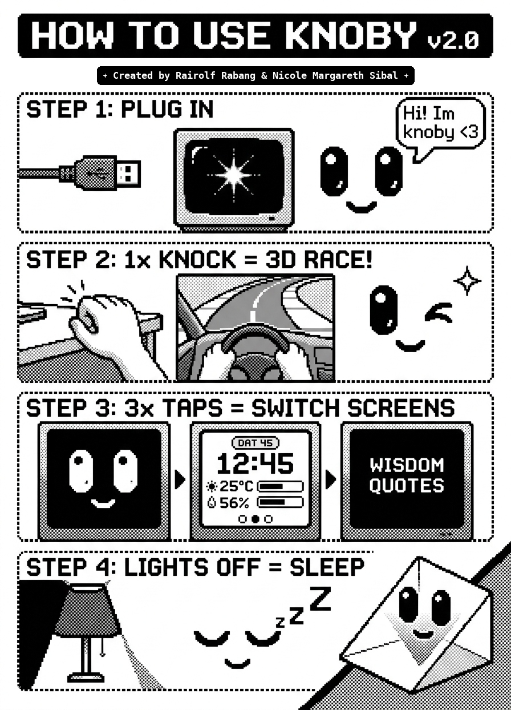
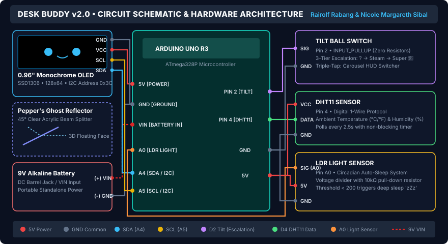

# 🔮 3D Hologram Desk Buddy v2.0 ("KNOBY")

<div align="center">

[](LICENSE)
[](https://www.arduino.cc/)
[](https://learn.adafruit.com/monochrome-oled-breakouts)
[](DeskBuddy/DeskBuddy.ino)
[](#-peppers-ghost-optical-assembly)
[](https://tofutof.github.io/KNOBY/)
[](#-quick-start)

**An interactive 3D Pepper's Ghost Hologram Desktop Companion powered by an Arduino UNO R3, built on an extra-small mini breadboard for a sleek, compact, and aesthetic desk companion.**

*Created by **Rairolf Rabang** & **Nicole Margareth Sibal***

<br />



<p align="center">
  <a href="https://tofutof.github.io/KNOBY/"><strong>🌐 Launch Live Interactive Web Manual & Guide (tofutof.github.io/KNOBY)</strong></a>
</p>

</div>

---

## 📖 Overview

**KNOBY v2.0** is an interactive, micro-optics desktop companion that brings artificial life to your workspace without requiring bulky headsets or specialized 3D screens. Using the classic **Pepper's Ghost beam-reflection optical illusion**, Knoby projects crisp, high-contrast imagery from a 0.96" I2C OLED display onto a 45-degree semi-reflective transparent prism, making the graphics appear suspended in mid-air.

Powered by a single 8-bit Microchip ATmega328P microcontroller, Knoby combines autonomous life-like eye gaze behaviors, physical desk vibration gesture detection, live climate monitoring, circadian sleep cycles, and a custom integer-based 3D perspective racing animation running smoothly at over **35 FPS**.

---

## 🌟 Key Features

### 🤖 1. Xiaozhi-Inspired Interactive Face Engine
- **Fluid Gaze Engine:** Liquid-smooth Lerp interpolation across the display. Knoby inspects his surroundings (looking left, right, curious upward glances, and resting downward glances) with organic hold durations (1.5–3.0s).
- **Progressive Squash-and-Stretch Blinking:** Frame-by-frame non-linear eyelid curves with blinks synchronized during gaze transitions.
- **3D Pupil Parallax & Hologram Gloss:** Black pupils lead eye motion with micro-reflection specular highlights for realistic depth.
- **Connected 3D Mouth Perspective:** The mouth dynamically offsets with dampened parallax, making the face turn as a cohesive 3D head.

### 🏎️ 2. 3D Arcade Cockpit Racer & Victory Wink (Single Tap)
- Tapping or knocking on the desk triggers an interactive 3D first-person retro arcade cockpit racer.
- Features parabolic S-curve drifting, a tilting F1 sports steering wheel with Knoby's paws, rearview mirror, nitro boost, and a camera pan-out to Knoby winking with a sparkling anime star (`^ ~`)✦!

### 🌙 3. Circadian Auto-Sleep Engine
- Uses an ambient photoresistor (LDR) to track room illumination.
- Turning off room lights triggers a gradual eyelid droop into deep sleep with floating 3D hologram `z Z Z` animations.
- Turning lights back on gently awakens Knoby with a smile!

### 📊 4. Triple-Tap Gesture Navigation
A miniature vibration/tilt switch allows quick gesture control:
- **Page 1: Companion Face** — Living, breathing digital pet with gaze tracking.
- **Page 2: Environmental HUD** — Real-time clock (`HH:MM:SS`), calendar date, ambient temperature (°C & °F), relative humidity (%), and comfort index.
- **Page 3: Daily Wisdom Quotes** — Inspiring quotes stored in Flash `PROGMEM` with synchronized animated mouth chattering.

### 🔮 5. Native Optical Hologram Mirroring
- Utilizes hardware SSD1306 register commands (`0xA0`/`0xA1`) to horizontally mirror output natively in display silicon, ensuring reflected text and graphics read correctly without software buffering overhead.

---

## 🧰 Bill of Materials (BOM)

| Component | Specification | Quantity | Purpose |
| :--- | :--- | :---: | :--- |
| **Arduino UNO R3** | ATmega328P (16 MHz, 32KB Flash, 2KB SRAM) | 1 pc | Central Processing Unit |
| **Monochrome OLED Display** | 0.96" I2C SSD1306 (128x64 px) | 1 pc | High-contrast hologram projection source |
| **Mini Breadboard** | 170 Tie-Points (SYB-170) | 1 pc | Ultra-compact hardware mounting base |
| **Tilt Ball Switch** | SW-520D / Ball sensor | 1 pc | Desk tap vibration & triple-tap navigation |
| **Photoresistor (LDR)** | 5mm GL5528 Analog Sensor | 1 pc | Ambient light tracking for circadian sleep |
| **10kΩ Resistor** | 1/4W Carbon Film (Brown-Black-Orange) | 1 pc | Voltage divider pull-down for LDR |
| **DHT11 Sensor** | Single-bus Digital Sensor | 1 pc | Ambient temperature & relative humidity |
| **Reflector Sheet** | Clear Rigid Acrylic / Plastic (45° angle) | 1 pc | Pepper's Ghost optical beam splitter |
| **Power Supply** | 9V Battery with DC Barrel Jack or USB 5V | 1 pc | System power |

---

## 🔌 Pinout & Wiring Configuration

All sensors and the display connect directly to the Arduino Uno R3:

```
                  +-----------------------------------+
                  |          ARDUINO UNO R3           |
                  +-----------------------------------+
                             |       |        |
        +--------------------+       |        +--------------------+
        |                            |                             |
+---------------+            +---------------+             +---------------+
|   OLED 0.96"  |            |  TILT SWITCH  |             |  DHT11 SENSOR |
|  (SSD1306)    |            |   (SW-520D)   |             |  TEMP/HUMID   |
+---------------+            +---------------+             +---------------+
| VCC -> 5V     |            | Leg 1 -> Pin 2|             | VCC  -> 5V    |
| GND -> GND    |            | Leg 2 -> GND  |             | GND  -> GND   |
| SCL -> A5/SCL |            | (INPUT_PULLUP)|             | DATA -> Pin 4 |
| SDA -> A4/SDA |            +---------------+             +---------------+
+---------------+
        |
+-----------------------------------+
|     PHOTORESISTOR (LDR) SUITE     |
+-----------------------------------+
| 5V -> LDR -> Pin A0 -> 10kΩ -> GND|
+-----------------------------------+
```

<div align="center">
  
</div>

> 📘 **Detailed Breadboard Layout:** See our full [Wiring & Optics Guide](docs/WIRING_GUIDE.md) for step-by-step breadboard column assignments and voltage divider wiring.

> ⚠️ **Safety Tip:** Always inspect your OLED module silkscreen before wiring! Some variants have `GND-VCC-SCL-SDA` while others have `VCC-GND-SCL-SDA`. Connecting power backwards will permanently damage the SSD1306 controller.

---

## 🔮 Pepper's Ghost Optical Assembly

To achieve the floating holographic illusion:

```
               [ Eyeline of Viewer ]
                       \
                        \
                         v
                    / 45° Reflector (Clear Acrylic)
                   /
                  /   <-- Ghost image reflects here in mid-air!
                 /
      [ OLED Screen ] (Lying flat, projecting upward)
      ===============================================
               [ Arduino & Mini-Breadboard ]
```

1. Position the OLED display flat on the mini-breadboard, facing straight up.
2. Mount the transparent acrylic or clear plastic sheet directly above the display angled at **45 degrees** leaning toward the viewer.
3. Darken the background behind the reflector for maximum holographic contrast.

---

## ⚡ Quick Start

### 1. Prerequisites & Libraries
Install the [Arduino IDE](https://www.arduino.cc/en/software) (version 2.x recommended).

Open **Tools -> Manage Libraries...** and install:
- **Adafruit SSD1306** (v2.5.10 or higher)
- **Adafruit GFX Library** (v1.11.9 or higher)

*(Note: The DHT11 driver is written directly in firmware via non-blocking bit-banging, so no third-party DHT library is needed!)*

### 2. Flashing the Firmware
1. Clone this repository:
   ```bash
   git clone https://github.com/tofutof/KNOBY.git
   cd KNOBY
   ```
2. Open [`DeskBuddy/DeskBuddy.ino`](DeskBuddy/DeskBuddy.ino) in Arduino IDE.
3. Under **Tools -> Board**, select **Arduino Uno**.
4. Under **Tools -> Port**, select the USB serial port for your board.
5. Click **Upload** (Ctrl+U / Cmd+U).

> 📘 **Step-by-Step Build Guide:** See our full [Step-by-Step Setup Guide](docs/STEP_BY_STEP_SETUP_GUIDE.md) for detailed hardware assembly, testing instructions, and [Project Functionality Specification](docs/PROJECT_FUNCTIONALITY.md).

---

## 📁 Repository Directory Structure

```text
DESK BUDDY/
├── .github/                      # GitHub issue and pull request templates
│   ├── ISSUE_TEMPLATE/
│   │   ├── bug_report.md
│   │   └── feature_request.md
│   └── pull_request_template.md
│
├── assets/                       # Infographics, schematics, and project media
│   ├── circuit_diagram.svg       # Vector circuit schematic diagram
│   └── knoby_pixel_infographic.jpg # Pixel-art user guide
│
├── DeskBuddy/                    # Core Arduino firmware sketch
│   ├── DeskBuddy.ino             # Production Arduino sketch firmware
│   └── README.md                 # Firmware configuration details
│
├── docs/                         # Detailed guides & live GitHub Pages manual
│   ├── index.html                # Live interactive web manual (GitHub Pages entry)
│   ├── STEP_BY_STEP_SETUP_GUIDE.md # Beginner step-by-step maker guide
│   ├── WIRING_GUIDE.md           # Mini-breadboard visual wiring guide
│   ├── PROJECT_FUNCTIONALITY.md  # Detailed engineering & functional specs
│   └── assets/                   # Web-served schematics & infographics
│
├── CONTRIBUTING.md               # Community guidelines for contributions
├── CODE_OF_CONDUCT.md            # Contributor Covenant v2.1
├── SECURITY.md                   # Vulnerability disclosure policy
├── LICENSE                       # MIT Open Source License
└── README.md                     # Project overview (this file)
```

---

## 👥 Authors & Maintainers

- **Rairolf Rabang** — *Lead Firmware & Hardware Architecture* — [@tofutof](https://github.com/tofutof)
- **Nicole Margareth Sibal** — *Optics Design, Project Verification & Case Study*

---

## 📄 License

This project is licensed under the **MIT License** — see the [LICENSE](LICENSE) file for details.
Feel free to use, modify, and build your own Desk Buddy! Contributions are warmly welcome.
